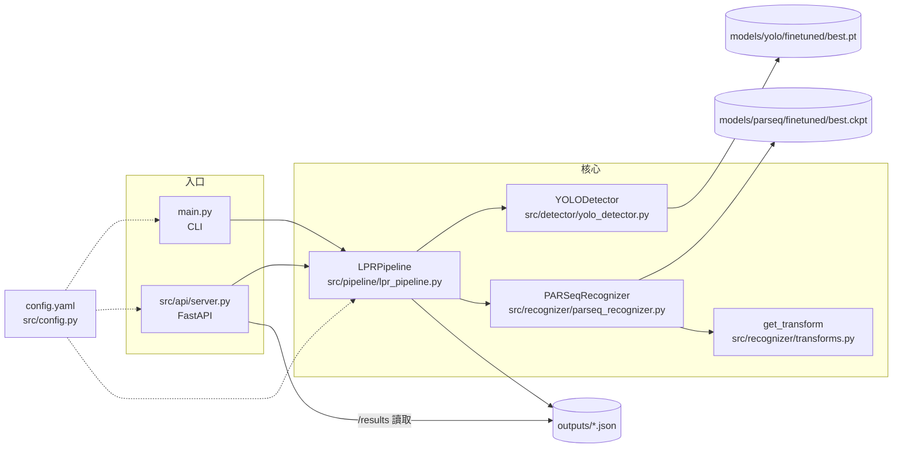
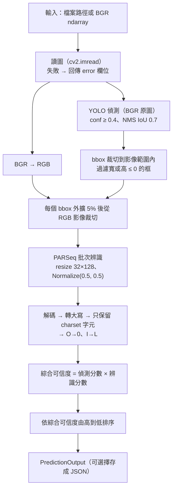

# ALPR 台灣車牌辨識系統 — 技術文件素材

> 本文件整理撰寫正式技術文件所需的完整技術細節：系統架構、模型、資料集、訓練、評估、API 規格、部署與已知限制。
> 內容依據專案原始碼與實際量測結果整理。
>
> - 程式碼版本：commit `a759fa4`（branch `main`）之後的工作目錄
> - 整理日期：2026-11-20
> - 模型卡（效能與綜合分數、超參數影響實驗、訓練 / 推論時間、最低軟硬體需求、使用手冊）另見 `MODEL_CARD.md`
> - 量測環境：Intel Core i7-14700F（28 執行緒）、NVIDIA GeForce RTX 4090（24 GB）、Ubuntu（Linux 6.8）

---

## 目錄

1. [系統概述](#1-系統概述)
2. [系統架構](#2-系統架構)
3. [推論流程（逐步說明）](#3-推論流程逐步說明)
4. [模型細節：YOLO 車牌偵測](#4-模型細節yolo-車牌偵測)
5. [模型細節：PARSeq 字元辨識](#5-模型細節parseq-字元辨識)
6. [資料集](#6-資料集)
7. [評估方法與結果](#7-評估方法與結果)
8. [設定系統（config.yaml）](#8-設定系統configyaml)
9. [REST API 規格](#9-rest-api-規格)
10. [CLI 使用方式](#10-cli-使用方式)
11. [輸出檔案格式](#11-輸出檔案格式)
12. [模型訓練流程](#12-模型訓練流程)
13. [實驗紀錄（trackio）](#13-實驗紀錄trackio)
14. [部署（Docker）](#14-部署docker)
15. [Log](#15-log)
16. [安全性](#16-安全性)
17. [自動化測試與覆蓋率](#17-自動化測試與覆蓋率)
18. [已知限制與待改進事項](#18-已知限制與待改進事項)
19. [相依套件版本](#19-相依套件版本)
20. [附錄：名詞對照](#20-附錄名詞對照)

---

## 1. 系統概述

### 1.1 目的

從車輛影像中自動找出台灣車牌並辨識車牌號碼（例如 `ABC-1234`），提供：

- **CLI**：單張辨識、資料夾批次辨識、以 ground truth 評估準確率。
- **REST API**（FastAPI）：上傳影像取得辨識結果，並可查詢歷史結果；以 Bearer token 控管存取。
- **訓練工具**：訓練 PARSeq 字元辨識模型、fine-tune YOLO 車牌偵測模型，訓練曲線記錄在 trackio。

### 1.2 兩階段架構

| 階段 | 模型 | 輸入 | 輸出 |
|------|------|------|------|
| 1. 偵測（Detection） | YOLOv8n（Ultralytics） | 整張影像（BGR） | 每個車牌的 bounding box 與偵測信心分數 |
| 2. 辨識（Recognition） | PARSeq（ViT encoder + Transformer decoder） | 裁切後的車牌影像（resize 為 32×128） | 車牌字串與辨識信心分數 |

兩階段分開的好處：

- 偵測與辨識可以**各自訓練、各自替換**權重。
- 偵測模型只需要「車牌」一個類別，辨識模型只看車牌區域，兩邊的學習目標都單純。

### 1.3 技術棧

| 類別 | 技術 |
|------|------|
| 語言 | Python 3.11 |
| 深度學習框架 | PyTorch 2.11（CUDA 13.0 wheel）、torchvision 0.26 |
| 偵測 | Ultralytics 8.4.56（YOLOv8n 架構） |
| 辨識 | PARSeq（`baudm/parseq`，經 `torch.hub` 載入） |
| 影像處理 | OpenCV、Pillow |
| API | FastAPI 0.136、Uvicorn 0.47、python-multipart |
| 設定 / 資料驗證 | pydantic 2.13、pydantic-settings 2.14（YAML + 環境變數） |
| Log | loguru |
| 實驗紀錄 | trackio 0.45（本機 SQLite + 網頁儀表板） |
| 環境 / 部署 | conda（`environment.yml`）、Docker、Docker Compose、NVIDIA Container Toolkit |

---

## 2. 系統架構

### 2.1 元件關係



### 2.2 專案結構

```
ALPR/
├── config.yaml                    # 所有設定的唯一來源
├── main.py                        # CLI 入口（辨識 / 評估 / 啟動 API）
├── environment.yml                # conda「ALPR」環境（Docker 也用這份建置）
├── src/
│   ├── config.py                  # 讀取與驗證 config.yaml（pydantic-settings）
│   ├── models.py                  # 所有輸入輸出資料結構（pydantic）
│   ├── evaluation.py              # 以 GT CSV 評估準確率
│   ├── detector/yolo_detector.py  # YOLO 車牌偵測
│   ├── recognizer/
│   │   ├── parseq_recognizer.py   # PARSeq 字元辨識 + 後處理
│   │   └── transforms.py          # 訓練與推論共用的影像前處理
│   ├── pipeline/lpr_pipeline.py   # 偵測 + 裁切 + 辨識 + 存檔
│   ├── api/server.py              # FastAPI 服務（驗證、端點、結果查詢）
│   ├── train/train.py             # 訓練 PARSeq
│   ├── finetune/finetune_yolo.py  # Fine-tune YOLO
│   └── utils/
│       ├── logger.py              # loguru 設定
│       ├── image.py               # 讀圖、色彩轉換、裁切、列出影像
│       ├── dataset.py             # 讀取 GT CSV（含路徑解析規則）
│       ├── tracking.py            # trackio 實驗紀錄
│       ├── trackio_export.py      # 把 trackio 的 run 匯出成 trackio 相容 CSV
│       └── files.py               # 訓練輸出資料夾的整份取代
├── models/                        # 權重（見 4.3、5.3）
│   ├── yolo/pretrained/           #   fine-tune 起點
│   ├── yolo/finetuned/            #   推論使用的 YOLO 權重
│   └── parseq/finetuned/          #   推論使用的 PARSeq 權重
├── data/                          # 資料集（不進 git）
├── outputs/                       # 辨識 / 評估結果 JSON、推論 log（不進 git）
├── logs/trackio/                  # trackio 資料庫（不進 git）
├── MODEL_CARD.md                  # 模型卡（效能、超參數、資料集、需求、使用手冊）
├── docs/training_logs/            # 目前權重的訓練紀錄（trackio 相容 CSV + 設定）
├── tests/                         # 自動化測試（pytest，見 17）
├── pyproject.toml                 # pytest / 覆蓋率設定
├── requirements-dev.txt           # 測試用套件（不放進 Docker 映像）
└── docker/                        # Dockerfile、docker-compose.yml、.env（.env 不進 git）
```

### 2.3 主要類別與職責

| 類別 / 函式 | 檔案 | 職責 |
|-------------|------|------|
| `AppConfig` | `src/config.py` | 讀取 `config.yaml` + 環境變數，以 pydantic 驗證；欄位缺漏或多餘都會直接報錯 |
| `LPRPipeline` | `src/pipeline/lpr_pipeline.py` | 串接偵測與辨識；提供 `predict` / `predict_batch` / `predict_folder` / `save_batch` / `warmup` |
| `YOLODetector` | `src/detector/yolo_detector.py` | 載入 YOLO 權重；`detect(image_bgr)` 回傳依分數排序的 bbox |
| `PARSeqRecognizer` | `src/recognizer/parseq_recognizer.py` | 載入 PARSeq；`recognize_batch(crops)` 回傳文字與分數；含字元過濾與後處理 |
| `get_transform` | `src/recognizer/transforms.py` | PARSeq 前處理（訓練可加資料增強），訓練與推論共用，確保一致 |
| `evaluate` | `src/evaluation.py` | 對 GT CSV 跑整條 pipeline，計算完全正確率與字元準確率 |
| `ExperimentTracker` | `src/utils/tracking.py` | 包裝 trackio，紀錄訓練指標 |
| `replace_dir` | `src/utils/files.py` | 以「先複製到 `.new` 再 rename」的方式整份取代輸出資料夾 |

---

## 3. 推論流程（逐步說明）

`LPRPipeline.predict(source)` 對一張影像的處理步驟：



| 步驟 | 說明 | 相關設定 |
|------|------|----------|
| 1. 讀圖 | 路徑輸入用 `cv2.imread`（BGR）；API 上傳用 `cv2.imdecode`。讀取失敗不拋例外，回傳帶 `error` 的結果 | — |
| 2. 色彩轉換 | YOLO 直接用 BGR 原圖（Ultralytics 把 numpy 輸入視為 BGR）；另外轉一份 RGB 給 PARSeq 裁切用（PARSeq 的前處理以 RGB 為準） | — |
| 3. 偵測 | `YOLO.predict(conf=threshold, device=...)`；其餘參數用 Ultralytics 預設：NMS IoU 0.7、`max_det` 300、輸入 resize 到 640（letterbox）、FP32 | `detector.confidence_threshold`（0.4）、`detector.device` |
| 4. bbox 後處理 | 座標 clamp 到影像範圍，去掉退化的框，依 `detector_score` 由高到低排序 | — |
| 5. 裁切 | 每邊外擴 bbox 寬 / 高的 `crop_padding` 倍（預設 5%），再 clamp 到影像範圍 | `recognizer.crop_padding`（0.05） |
| 6. 辨識 | 同一張影像的所有車牌一次組成 batch 送進 PARSeq | `recognizer.device` |
| 7. 後處理 | 轉大寫，只保留 `charset` 中的字元，再把 `O` 換成 `0`、`I` 換成 `L` | `recognizer.charset` |
| 8. 分數 | `recognizer_score` = 各字元（含結束符號）機率的平均；`confidence` = `detector_score × recognizer_score`，四捨五入到小數 4 位 | — |
| 9. 排序 / 輸出 | `plates` 依 `confidence` 由高到低排序；`processing_time_ms` 是步驟 1 到 8 的耗時 | `output_dir` |

**暖機（warmup）**：API 啟動時用全黑影像（YOLO 640×640、PARSeq 32×128）各推論一次，讓第一個真正的請求不用負擔初始化成本。

**多車牌**：一張影像可回傳多個車牌，全部放在 `plates` 陣列。評估（第 7 章）只取 `confidence` 最高的那一個。

---

## 4. 模型細節：YOLO 車牌偵測

### 4.1 架構

| 項目 | 值 |
|------|----|
| 架構 | YOLOv8n（`yolov8n.yaml`，scale `n`），anchor-free 偵測頭 |
| 任務 | detect，1 個類別（`plate`） |
| 參數量 | 3,011,043（約 3.0 M） |
| 權重檔大小 | 約 6.2 MB（`best.pt`） |
| 輸入尺寸 | 640×640（letterbox） |
| 輸出 | 每個框的 `xyxy` 座標（原圖像素座標）與信心分數 |

### 4.2 權重來源與譜系

```
yolov8n.yaml（從頭訓練，非 COCO 預訓練）
  └─ models/yolo/pretrained/license_plate_detector.pt
       外部取得的車牌偵測權重：2023-06-04 以 Ultralytics 8.0.112 訓練，
       30 epochs、SGD、lr0 0.01、batch 16、imgsz 640，類別名 license_plate
       └─ models/yolo/finetuned/best.pt     ← 推論使用
            2026-11-13 以 Ultralytics 8.4.56 從 license_plate_detector.pt 的權重開始，
            在 data/finetune_dataset 上 fine-tune 50 epochs（AdamW、lr0 5e-4）
```

### 4.3 權重檔

| 檔案 | 說明 |
|------|------|
| `models/yolo/pretrained/license_plate_detector.pt` | fine-tune 的起點（`finetune_yolo.finetune_from`） |
| `models/yolo/finetuned/best.pt` | 驗證集 fitness（0.1 × mAP50 + 0.9 × mAP50-95）最高的 epoch（epoch 40），**推論使用**（`detector.weights_path`） |
| `models/yolo/finetuned/last.pt` | 最後一個 epoch |
| `models/yolo/finetuned/results.csv` | 每個 epoch 的 loss、precision、recall、mAP、學習率 |
| `models/yolo/finetuned/args.yaml` | Ultralytics 記錄的完整訓練參數 |
| `models/yolo/finetuned/finetune_yolo.log` | 訓練腳本的 log（不含 Ultralytics 逐 epoch 的輸出） |

### 4.4 Fine-tune 設定（目前 `best.pt` 實際使用的值，取自 `args.yaml`）

| 參數 | 值 | 來源 |
|------|----|------|
| 起點權重 | `license_plate_detector.pt`（355 / 355 個參數張量全部載入） | `finetune_yolo.finetune_from` |
| 資料集 | `data/finetune_dataset`（見 6.2） | `finetune_yolo.data_root` |
| epochs | 50 | config |
| batch | 16 | config |
| imgsz | 640 | config |
| optimizer | AdamW | config（`finetune_yolo.optimizer`） |
| 初始學習率 lr0 | 5e-4 | config（`finetune_yolo.lr`） |
| AdamW β1 | 0.937（Ultralytics 的 `momentum` 參數） | Ultralytics 預設 |
| 最終學習率比例 lrf | 0.01（線性衰減，最後一個 epoch 的學習率為 1.49e-05） | Ultralytics 預設 |
| weight decay | 0.0005 | Ultralytics 預設 |
| warmup | 3 epochs | Ultralytics 預設 |
| early stopping patience | 20 | config |
| freeze | 不凍結 | config（`freeze: 0`） |
| seed | 42 | config |
| AMP | 開啟 | Ultralytics 預設 |
| 資料增強 | mosaic 1.0（最後 10 epochs 關閉）、水平翻轉 0.5、HSV（h 0.015 / s 0.7 / v 0.4）、scale 0.5、translate 0.1、copy_paste 0 | Ultralytics 預設 |
| 訓練時間 | 約 3 分鐘（50 epochs，Ultralytics 計時 172 秒，RTX 4090） | |

### 4.5 訓練結果（驗證集 400 張）

| 指標 | 起點 `license_plate_detector.pt` | **fine-tune 後 `best.pt`（epoch 40）** |
|------|------|------|
| Precision | 0.934 | **1.000** |
| Recall | 0.925 | **0.997** |
| mAP@0.5 | 0.898 | **0.995** |
| mAP@0.5:0.95 | 0.289 | **0.783** |

- 兩者都用 Ultralytics `model.val` 在同一個驗證集上量測（imgsz 640）。
- mAP@0.5:0.95 從 0.289 提升到 0.783：起點權重找得到車牌，但框得不夠準；fine-tune 後框的位置與大小明顯更貼近標註。
- 第 1 個 epoch 的 mAP@0.5 就達到 0.995，之後主要提升 mAP@0.5:0.95（epoch 1：0.538 → epoch 40：0.784）。
- `best.pt` 是 epoch 40（fitness 最高）；`last.pt` 是 epoch 50。
- 起點與 fine-tune 後在整條 pipeline 上的差異見 7.4。

> 這個驗證集和訓練集有重疊（見 6.2），數字可能偏樂觀。

### 4.6 推論參數

| 參數 | 值 | 設定 |
|------|----|------|
| 信心門檻 | 0.4（選擇依據見 4.7） | `detector.confidence_threshold` |
| NMS IoU | 0.7 | Ultralytics 預設（程式未指定） |
| 每張影像最多框數 | 300 | Ultralytics 預設 |
| 精度 | FP32 | Ultralytics 預設 |
| 裝置 | `cpu`（config）；Docker GPU 版改為 `cuda` | `detector.device` |

### 4.7 偵測門檻的選擇

用 `conf=0.01` 跑偵測（目前的 `best.pt`），統計不同門檻下的正確框（TP，與 GT IoU ≥ 0.5）與誤判框（FP）：

| 門檻 | finetune_dataset valid（400 個車牌）TP / FP | finetune_dataset test（200 個車牌）TP / FP | taiwan test（84 張）漏抓 / 多出第二個框的張數 |
|------|------|------|------|
| 0.05 | 399 / 59 | 200 / 37 | 0 / 64 |
| 0.10 | 399 / 20 | 200 / 18 | 0 / 59 |
| 0.15 | 399 / 12 | 200 / 8 | 0 / 49 |
| 0.20 | 399 / 9 | 200 / 5 | 0 / 29 |
| 0.25 | 398 / 5 | 200 / 4 | 0 / 4 |
| 0.30 | 398 / 5 | 200 / 3 | 0 / 1 |
| **0.40** | **398 / 1** | **200 / 1** | **0 / 1** |
| 0.50 | 398 / 1 | 200 / 1 | 0 / 1 |

分數分佈：

| | 正確框（真車牌）的分數 | 誤判框的分數 |
|---|---|---|
| finetune_dataset valid | 除了 2 個以外都 ≥ 0.71（另外 2 個是 0.246 與 0.014） | 大多 ≤ 0.40，最高 0.518 |
| finetune_dataset test | 全部 ≥ 0.72 | 大多 ≤ 0.40，最高 0.508 |
| taiwan test（每張最高分 / 第二高分） | 每張最高分都 ≥ 0.65 | 第二個框大多 ≤ 0.28，最高 0.508 |

- 真車牌的分數幾乎都在 0.65 以上，誤判框幾乎都在 0.40 以下，兩者之間有明顯的間隔。
- 選 **0.4**：抓到的真車牌與 0.25 完全相同，誤判框從 4–5 個降到 1 個；taiwan test 多出第二個框的影像從 4 張降到 1 張。
- 0.4 與 0.5 在這三個資料集上結果相同；選 0.4 是為了離真車牌的分數（≥ 0.65）保留較大的餘裕。
- finetune_dataset valid 有 2 個車牌分數很低（0.246、0.014），任何合理門檻都抓不到。
- 整條 pipeline 在門檻 0.25 與 0.4 下的準確率相同（test、valid 都是 100%）。
- 誤判框不影響評估（評估只取可信度最高的車牌），但會出現在 API 回應的 `plates` 中。

---

## 5. 模型細節：PARSeq 字元辨識

### 5.1 模型簡介

PARSeq（Permutation Autoregressive Sequence，Bautista & Atienza, ECCV 2022）是場景文字辨識（Scene Text Recognition, STR）模型：

- **Encoder**：Vision Transformer（ViT），把文字影像切成 patch 編碼成視覺特徵。
- **Decoder**：Transformer decoder，用 position query 對視覺特徵做 cross-attention，逐字輸出。
- **訓練方式：Permutation Language Modeling（PLM）**。訓練時隨機採樣多種「字元輸出順序」（排列），讓同一個模型同時學會：
  - 由左到右的自迴歸（autoregressive）解碼；
  - 不依賴順序的並行（non-autoregressive）解碼；
  - 根據上下文修正的迭代精修（cloze refinement）。

### 5.2 架構參數（取自 checkpoint 的 `hyper_parameters`）

| 項目 | 值 |
|------|----|
| 輸入尺寸 | 32×128（高×寬），RGB |
| Patch 大小 | 4×8 → 8×16 = 128 個 patch |
| Embedding 維度 | 384 |
| Encoder | 12 層、6 個 attention head、MLP ratio 4 |
| Decoder | 1 層、12 個 attention head、MLP ratio 4 |
| Dropout | 0.1 |
| 最大字串長度 | 25（position query 26 個，含結束符號） |
| 訓練用字元集（tokenizer） | 94 個可列印 ASCII 字元（數字、大小寫字母、標點） |
| 輸出類別數 | 95（94 字元 + 結束符號 `[E]`） |
| 排列數 perm_num | 6（含正向與鏡像排列） |
| 推論解碼 | 自迴歸解碼（`decode_ar=True`）+ 1 次精修（`refine_iters=1`） |
| 參數量 | 23,832,671（約 23.8 M）：encoder 21.38 M、decoder 2.37 M、head 0.04 M、text embedding 0.04 M、position query 0.01 M |
| 權重檔大小 | 約 95 MB（FP32） |

### 5.3 權重來源與檔案

- **起點**：`torch.hub` 上 `baudm/parseq` 的官方預訓練權重（`parseq-bb5792a6.pt`），是在一般場景文字資料上訓練的模型，沒有看過台灣車牌。
- **目前推論使用的權重**：從官方預訓練權重開始，在 `taiwan_plate_dataset` 上訓練 30 epochs（2026-11-13）。

| 檔案 | 說明 |
|------|------|
| `models/parseq/finetuned/best.ckpt` | 訓練中驗證結果最好的 epoch（epoch 28，選擇規則見 5.6），**推論使用**（`recognizer.weights_path`） |
| `models/parseq/finetuned/last.ckpt` | 最後一個 epoch（epoch 30） |
| `models/parseq/finetuned/loss_curve.png` | 每個 epoch 的 train / val loss 曲線 |
| `models/parseq/finetuned/train.log` | 完整訓練 log |

**Checkpoint 格式**（`torch.save` 的 dict）：

| key | 內容 |
|-----|------|
| `epoch` | 儲存時的 epoch |
| `model_state_dict` | 模型權重 |
| `hyper_parameters` | 建立模型所需的超參數（推論時傳給 `torch.hub.load` 重建同樣的架構） |
| `val_acc` | 該 epoch 的驗證準確率 |

**載入方式**：用 `torch.hub.load("baudm/parseq:main", "parseq", pretrained=False, **hyper_parameters)` 建立架構，再 `load_state_dict`。

- 明確指定 `:main` branch：沒指定時，torch.hub 每次載入都會連 GitHub 判斷預設 branch，GitHub 回 5xx 時就算本機有快取也會失敗。
- `weights_path` 指向的檔案不存在時，退回使用 `torch.hub` 的預訓練模型（`model_variant`：`parseq` 或 `parseq_tiny`），log 會出現警告。

### 5.4 前處理（訓練與推論共用 `src/recognizer/transforms.py`）

推論：

1. `Resize((32, 128), BICUBIC)`（不保持長寬比，直接拉伸）
2. `ToTensor()`
3. `Normalize(mean=0.5, std=0.5)` → 數值範圍 [-1, 1]

訓練時在 resize 前加入資料增強（只用於訓練集）：

| 增強 | 參數 | 套用機率 |
|------|------|----------|
| RandomPerspective | distortion 0.12，填充灰色 127 | 0.25 |
| RandomAffine | 旋轉 ±3°、平移 (2.5%, 5%)、縮放 0.9–1.1、shear ±2°，填充 127 | 0.50 |
| GaussianBlur | kernel 3、sigma 0.1–1.2 | 0.25 |
| ColorJitter | 亮度 0.30、對比 0.35、飽和度 0.10、色相 0.02 | 0.60 |
| RandomAutocontrast | — | 0.15 |

### 5.5 Loss（`compute_loss`，與官方 PARSeq 訓練一致）

1. 標籤經 tokenizer 編碼為 `[B] c1 c2 … cn [E] [P] …`。
2. Encoder 計算一次影像特徵 `memory`。
3. 產生 6 種排列（`gen_tgt_perms`，含正向與鏡像），每種排列產生對應的 attention mask。
4. 每種排列各算一次 decoder 輸出的 cross-entropy（忽略 padding），以 token 數加權平均。
5. 前 2 種排列（正向與其鏡像）之後，把 `[E]` 也換成 padding，後續排列不學習結束符號（官方實作的做法）。

### 5.6 訓練設定（`config.yaml` 的 `train_parseq`）

| 參數 | 值 |
|------|----|
| 起點 | torch.hub 官方預訓練權重（`finetune_from: null`） |
| 訓練集 / 驗證集 | `taiwan_plate_dataset` train（5,204 張）/ valid（76 張） |
| 驗證影像前處理 | 先用 YOLO 裁出車牌（`crop_val: true`），與推論 pipeline 的輸入相同 |
| epochs | 30 |
| batch size | 64 |
| optimizer | AdamW，lr 5e-5，weight decay 0.01 |
| 學習率排程 | CosineAnnealingLR，每個 step 更新，`T_max = epochs × 每 epoch step 數` |
| gradient clipping | max norm 5.0 |
| freeze_encoder | false（整個模型都訓練） |
| DataLoader workers | 4 |
| seed | 42 |
| 裝置 | 有 GPU 就用 CUDA |

**驗證方式**：驗證要反映實際推論的情況，所以驗證時 PARSeq 看到的輸入與推論完全相同。

- **輸入**：訓練集本身就是裁切好的車牌；驗證集是 416×416 的整張影像，訓練開始時先用推論用的 YOLO（`detector` 設定的權重與門檻）偵測，取分數最高的框，以 `recognizer.crop_padding`（0.05）外擴後裁切。76 張全部偵測成功。
- **輸出**：模型輸出經過和推論相同的後處理（`normalize_plate_text`：轉大寫、只保留 `charset` 中的字元、`O → 0`、`I → L`），再與 GT 比對是否**完全相同**。

**模型選擇**：每個 epoch 結束時，在驗證集上算完全正確率與 val loss。準確率較高，或準確率相同但 val loss 較低時，才存 `best.ckpt`。

- 驗證集只有 76 張，準確率很快就會持平；加上 val loss 比較，才能在準確率相同的 epoch 中選出收斂最好的。
- 比較的起點是訓練前（epoch 0）的結果，所以只有比訓練前更好的 epoch 才會被存下來。

### 5.7 訓練結果

| 項目 | 驗證準確率 | val loss |
|------|-----------|----------|
| 訓練前（epoch 0，官方預訓練權重） | 90.79%（69/76） | 0.0627 |
| epoch 1 | 100.00% | 0.0112 |
| **最佳（epoch 28，`best.ckpt`）** | **100.00%** | **0.0038** |
| 最後一個 epoch（30，`last.ckpt`） | 100.00% | 0.0043 |

- 訓練時間約 3 分 10 秒（RTX 4090，每個 epoch 約 6 秒；驗證集裁切約 1 秒）。
- 第 1 個 epoch 驗證準確率就達到 100%，之後 val loss 大致持續下降，在 epoch 23、25、28 達到最低（約 0.0038，epoch 28 最低）。
- 驗證準確率與整條 pipeline 在 valid 上的準確率（7.3）一致，都是 100%。

### 5.8 推論輸出與後處理

1. Softmax → tokenizer 解碼（取每個位置機率最高的字元，遇到 `[E]` 截斷）。
2. `recognizer_score` = 各字元機率（含 `[E]`）的平均值。
3. 字串轉大寫，只保留 `charset` 中的字元（預設 `0123456789ABCDEFGHJKLMNPQRSTUVWXYZ-OI`）。步驟 3–4 實作在 `normalize_plate_text`，訓練中的驗證也使用同一個函式。
4. 台灣車牌後處理：`O` → `0`、`I` → `L`。台灣車牌不使用 I、O 兩個字母，資料集中也沒有出現。

---

## 6. 資料集

所有資料集都放在 `data/`，不進 git。

### 6.1 `data/taiwan_plate_dataset`（PARSeq 訓練與整體評估）

| 項目 | 內容 |
|------|------|
| 來源 | Roboflow Universe：High-precision Taiwan license plate number recognition（jackresearch3，version 5） |
| 授權 | CC BY 4.0 |
| 原始標註 | 逐字元的 YOLO 偵測標註（34 類：`-`、數字 0–9 不含 4、英文字母不含 I 與 O） |
| 本專案使用的標註 | 每個 split 一份 GT CSV（`image_path,plate_text`） |

| Split | 張數 | 影像尺寸 | 用途 |
|-------|------|----------|------|
| train | 5,204 | 多為裁切好的車牌（寬 416、高約 139–150），56 張為 416×416 | PARSeq 訓練 |
| valid | 76 | 全部 416×416 | PARSeq 訓練中的驗證 / 模型選擇 |
| test | 84 | 全部 416×416 | 整條 pipeline 的評估 |

**車牌格式分佈**（`A` = 字母、`9` = 數字）：

| 格式 | train | valid | test |
|------|-------|-------|------|
| `AAA-9999` | 4,137 | 62 | 69 |
| `999-AAA` | 575 | 10 | 12 |
| `AAA9999`（無 `-`） | 80 | — | — |
| `AA9-999` | 79 | 2 | 1 |
| `9999-AAA` | 60 | — | — |
| `A99-999` | 40 | — | — |
| `9999AAA` | 40 | — | — |
| `AAA-999A` | 40 | — | — |
| 其他 | 213 | 2 | 2 |

- 所有 split 都沒有出現字母 `I`、`O`，也沒有數字 `4`。
- **valid 與 test 有重疊**：test 的 84 張中有 56 張與 valid 是同一個檔案（檔名與 md5 相同）；train 與兩者沒有重疊。見 18.2。

**GT CSV 格式**

```csv
image_path,plate_text
000001_jpg.rf.150cb93320274f6b53f0ee4c5aafc560.jpg,MVN-9382
```

`image_path` 可以是絕對路徑或相對路徑。相對路徑依序嘗試以下位置，用第一個存在的檔案（`src/utils/dataset.py`）：

1. `--image-root` 指定的資料夾
2. CSV 所在資料夾
3. CSV 所在資料夾的上一層
4. CSV 所在資料夾底下的 `images/`

只要有任何一張找不到就直接報錯，避免默默少算樣本。

### 6.2 `data/finetune_dataset`（YOLO 偵測 fine-tune）

| 項目 | 內容 |
|------|------|
| 來源 | taiwan_plate Computer Vision Model dataset |
| 匯出格式 | Roboflow YOLO 格式（`<split>/images`、`<split>/labels`） |
| 用途 | YOLO 車牌偵測 fine-tune（train 訓練、valid 驗證） |

| Split | 影像數 | 標註 | 不同原圖數（依檔名前綴） |
|-------|--------|------|--------------------------|
| train | 1,400 | 1,400 | 795 |
| valid | 400 | 400 | 334 |
| test | 200 | 200 | 184（目前沒有程式使用） |

- 影像尺寸：640×640。
- 類別：1 類（`plate`），每張影像 1 個車牌。
- 標註格式：YOLO txt，`class x_center y_center width height`（0–1 正規化）。其中 264 個是 bbox 格式（5 個欄位），其餘是多邊形格式（`class x1 y1 x2 y2 …`），Ultralytics 會自動轉成外接矩形。
- 檔名格式為 Roboflow 匯出的 `<原圖名>_jpg.rf.<hash>.jpg`。同一張原圖有多個版本（增強後的副本）。
- **split 之間有重疊**（依檔名前綴判斷原圖）：train∩valid 239 張、train∩test 133 張、valid∩test 59 張。見 18.2。
- 沒有 `valid/` 時，fine-tune 腳本會從 train 依 `val_frac`（10%）隨機切出驗證集（seed 固定），以 symlink 放在暫存資料夾，不動原始資料。

---

## 7. 評估方法與結果

### 7.1 方法

`python main.py --eval <GT_CSV>`（`src/evaluation.py`）：

1. 讀取 GT CSV。
2. 每張影像跑完整 pipeline（偵測 + 辨識）。
3. 取 `confidence` 最高的車牌當作預測；沒有偵測到車牌則預測為空。
4. 計算指標並輸出報告（預設存到 `outputs/eval_<時間>.json`）。

### 7.2 指標定義

| 指標 | 定義 |
|------|------|
| 準確率（完全正確率，`accuracy`） | 預測字串與 GT **完全相同**（大小寫、`-` 都要一致）的比例 |
| 字元準確率（`char_accuracy`） | `1 − Σ編輯距離 / ΣGT 字元數`（Levenshtein 距離，插入 / 刪除 / 替換各算 1；最低為 0）。沒偵測到時，編輯距離 = GT 長度 |
| 未偵測到（`no_plate`） | 沒有任何框通過偵測門檻的張數 |

### 7.3 結果（目前權重：YOLO `finetuned/best.pt` + PARSeq `finetuned/best.ckpt`）

| 資料集 | 張數 | 完全正確 | 準確率 | 字元準確率 | 未偵測到 |
|--------|------|----------|--------|------------|----------|
| test | 84 | 84 | **100.00%** | 100.00% | 0 |
| valid | 76 | 76 | **100.00%** | 100.00% | 0 |

- CPU 與 GPU 的結果完全相同。
- 偵測門檻 0.4 下，test 與 valid 的每張影像都偵測到車牌；門檻 0.25 的結果相同。
- train 與 test 沒有重疊（檔名、原圖編號、檔案 md5 都不重複）；valid 與 test 有重疊，見 18.2。

### 7.4 Fine-tune 前後比較

四種權重組合在同一個評估流程下的結果（2026-11-13，GPU，偵測門檻 0.4）：

| 組合 | YOLO 權重 | PARSeq 權重 | test 準確率（84 張） | test 字元準確率 | valid 準確率（76 張） | valid 字元準確率 |
|------|-----------|-------------|---------------------|-----------------|----------------------|------------------|
| Fine-tune 前 | `pretrained/license_plate_detector.pt` | torch.hub 官方預訓練 | 94.05%（79） | 98.17% | 96.05%（73） | 98.32% |
| 只 fine-tune YOLO | `finetuned/best.pt` | torch.hub 官方預訓練 | 90.48%（76） | 98.78% | 90.79%（69） | 98.82% |
| 只 fine-tune PARSeq | `pretrained/license_plate_detector.pt` | `finetuned/best.ckpt` | 98.81%（83） | 98.93% | 98.68%（75） | 98.82% |
| **Fine-tune 後** | `finetuned/best.pt` | `finetuned/best.ckpt` | **100.00%（84）** | **100.00%** | **100.00%（76）** | **100.00%** |

- **偵測**：起點 YOLO 對 `000633`（GT `258-QEN`）的最高分只有 0.299，低於門檻，所以使用起點 YOLO 的兩個組合都漏抓這張；fine-tune 後的 YOLO 對這張的分數是 0.650。
- **辨識**：官方預訓練 PARSeq 的錯誤主要是漏掉 `-`（例如 `ADY-8639` → `ADY8639`），其次是形近字混淆（`W` / `N`、`Q` / `0`）與少讀最後一個字元。fine-tune PARSeq 修正了這些錯誤，是準確率提升的主要來源。
- **只 fine-tune YOLO** 時準確率反而略降：fine-tune 後的框比較貼近車牌，裁切範圍改變後，官方預訓練 PARSeq 漏掉 `-` 的情況變多。兩個模型都 fine-tune 後所有錯誤都消失。
- 字元準確率在 fine-tune 前就有 98% 以上，錯誤多半只差 1 個字元（漏抓的 `000633` 則整串算錯）。

### 7.5 推論速度（每張影像，test 84 張，已暖機）

| 裝置 | 平均 | P50 | P95 | 最大 |
|------|------|-----|-----|------|
| CPU（i7-14700F） | 48.1 ms | 45.2 ms | 61.0 ms | 65.2 ms |
| GPU（RTX 4090） | 18.9 ms | 19.2 ms | 19.7 ms | 21.6 ms |

- 計時範圍是 `processing_time_ms`：從讀圖到辨識完成，不含 JSON 存檔。
- 透過 API 時，另外還有上傳與解碼的時間。

---

## 8. 設定系統（config.yaml）

### 8.1 原則

- **單一來源**：所有設定都在專案根目錄的 `config.yaml`，程式碼不設任何預設值。
- **嚴格驗證**：欄位缺漏、拼錯或多出來，載入時都會直接報錯（pydantic `extra="forbid"`，且欄位沒有預設值）。
- **相對路徑**：以執行指令的目錄（專案根目錄）為基準。

### 8.2 覆寫優先順序

```
CLI 參數  >  環境變數 ALPR_<區塊>__<欄位>  >  config.yaml
```

- **換設定檔**：`--config other.yaml` 或 `ALPR_CONFIG=other.yaml`。
- **環境變數**：巢狀欄位用 `__` 分隔，例如：
  - `ALPR_DETECTOR__DEVICE=cuda`
  - `ALPR_API__TOKENS='{"web": "<token>"}'`（dict 用 JSON）
- **訓練腳本**：會依設定欄位自動產生 CLI 參數，例如 `--epochs 1`、`--batch-size 8`；Optional 欄位可以傳 `null` 清空。
- **刻意不讀 `.env` 檔**：設定只來自 `config.yaml` 與環境變數。

### 8.3 完整欄位

**推論**

| 欄位 | 目前值 | 說明 |
|------|--------|------|
| `detector.weights_path` | `models/yolo/finetuned/best.pt` | YOLO 權重；不存在時啟動失敗 |
| `detector.confidence_threshold` | 0.4 | 偵測信心門檻（0–1），選擇依據見 4.7 |
| `detector.device` | `cpu` | `cuda` / `mps` / `cpu` |
| `recognizer.weights_path` | `models/parseq/finetuned/best.ckpt` | PARSeq 權重；不存在時退回 torch.hub 預訓練模型 |
| `recognizer.model_variant` | `parseq` | 退回時使用的模型（`parseq` / `parseq_tiny`） |
| `recognizer.charset` | `0123456789ABCDEFGHJKLMNPQRSTUVWXYZ-OI` | 辨識結果只保留這些字元 |
| `recognizer.device` | `cpu` | `cuda` / `mps` / `cpu` |
| `recognizer.crop_padding` | 0.05 | 裁切時 bbox 外擴比例（0–0.5） |
| `output_dir` | `outputs` | 結果 JSON 與推論 log 的目錄；API 的 `/results` 也讀這裡 |
| `log_level` | `INFO` | `DEBUG` / `INFO` / `WARNING` / `ERROR` |

**API**

| 欄位 | 目前值 | 說明 |
|------|--------|------|
| `api.host` | `0.0.0.0` | 監聽位址 |
| `api.port` | 8000 | 監聽 port |
| `api.workers` | 1 | Uvicorn worker 行程數（每個行程各自載入一份模型） |
| `api.tokens` | `{}` | `{用戶端名稱: token}`；**不要寫在這個檔案**（會進 git），改用 `ALPR_API__TOKENS` 環境變數 |
| `api.max_upload_mb` | 10 | 單一上傳檔案的大小上限（MB） |
| `api.max_batch_files` | 20 | `/predict/batch` 一次最多幾個檔案 |
| `api.max_image_pixels` | 50,000,000 | 影像寬 × 高上限（約 8000×6000），防止解壓縮炸彈 |

**實驗紀錄**

| 欄位 | 目前值 | 說明 |
|------|--------|------|
| `tracking.enabled` | true | 是否紀錄到 trackio |
| `tracking.project` | `ALPR` | trackio 專案名稱 |
| `tracking.trackio_dir` | `logs/trackio` | trackio 資料庫目錄（`<project>.db`） |

**訓練 PARSeq（`train_parseq`）**

| 欄位 | 目前值 | 說明 |
|------|--------|------|
| `train_csv` | `data/taiwan_plate_dataset/train/train_gt.csv` | 訓練集 GT |
| `val_csv` | `data/taiwan_plate_dataset/valid/valid_gt.csv` | 驗證集 GT；`null` 時從訓練集切出 `val_frac` |
| `val_frac` | 0.1 | 自動切分比例 |
| `crop_val` | true | 驗證影像先用 YOLO 裁出車牌再交給 PARSeq（偵測權重 / 門檻與 `recognizer.crop_padding` 同推論設定）；`val_csv` 為 null 時驗證集取自已裁切的訓練集，不再裁切 |
| `epochs` / `batch_size` | 30 / 64 | |
| `lr` / `weight_decay` | 5e-5 / 0.01 | AdamW |
| `freeze_encoder` | false | true：只訓練 decoder 與 head |
| `num_workers` | 4 | DataLoader workers |
| `seed` | 42 | |
| `device` | null | null = 有 GPU 就用 CUDA |
| `output_dir` | `models/parseq/finetuned` | 訓練成功後整個取代 |
| `finetune_from` | null | null = torch.hub 預訓練權重；或填既有 checkpoint |

**Fine-tune YOLO（`finetune_yolo`）**

| 欄位 | 目前值 | 說明 |
|------|--------|------|
| `data_root` | `data/finetune_dataset` | 底下要有 `train/`、`valid/`（各含 `images/`、`labels/`） |
| `train_dir` / `val_dir` | null | 不填則用 `<data_root>/train`、`<data_root>/valid` |
| `val_frac` | 0.1 | 沒有 `valid/` 時的切分比例 |
| `model` | `yolov8n.pt` | `finetune_from` 為 null 時使用的預訓練權重 |
| `finetune_from` | `models/yolo/pretrained/license_plate_detector.pt` | fine-tune 起點 |
| `imgsz` / `epochs` / `batch_size` | 640 / 50 / 16 | |
| `optimizer` | `AdamW` | `SGD` / `Adam` / `AdamW` / `NAdam` / `RAdam` / `RMSProp`；不提供 `auto`（`auto` 會忽略 `lr`，由 Ultralytics 自行決定學習率） |
| `lr` | 5e-4 | 初始學習率 lr0 |
| `freeze` | 0 | 凍結前 N 層 |
| `patience` | 20 | early stopping |
| `device` | null | 例如 `"0"` 或 `"cpu"` |
| `workers` / `seed` | 4 / 42 | |
| `output_dir` | `models/yolo/finetuned` | fine-tune 成功後整個取代 |

---

## 9. REST API 規格

### 9.1 概要

| 項目 | 內容 |
|------|------|
| 框架 | FastAPI（OpenAPI 3.1），Uvicorn |
| Base URL | 本機：`http://<host>:8000`；Docker（預設）：`http://<host>:8001` |
| 互動式文件 | Swagger UI：`/docs`；ReDoc：`/redoc`；OpenAPI JSON：`/openapi.json`（三者都不需要 token） |
| 驗證 | `Authorization: Bearer <token>`（`/health` 與文件頁除外） |
| 請求格式 | 上傳影像用 `multipart/form-data` |
| 回應格式 | `application/json`（UTF-8） |
| 錯誤格式 | `{"detail": "<訊息>"}`（4xx 與 503；500 例外，見 9.6） |
| CORS | 允許所有來源、方法、標頭 |
| 時間格式 | ISO 8601，UTC（例如 `2026-11-04T12:00:00.000000+00:00`） |
| ID 格式 | UUID v4 字串 |

### 9.2 端點一覽

| 方法 | 路徑 | 需要 token | 說明 |
|------|------|------------|------|
| GET | `/health` | 否 | 健康檢查 |
| POST | `/predict` | 是 | 上傳單張影像辨識 |
| POST | `/predict/batch` | 是 | 上傳多張影像批次辨識 |
| GET | `/results/{result_id}` | 是 | 以 `job_id` 或 `batch_id` 查詢先前的結果 |
| GET | `/results` | 是 | 列出歷史結果（新的在前，分頁） |

### 9.3 驗證機制

- token 以 `{用戶端名稱: token}` 設定在 `api.tokens`，建議用環境變數 `ALPR_API__TOKENS='{"web": "<token>", "mobile": "<token>"}'`。
- 每個請求帶 `Authorization: Bearer <token>`。
- 驗證成功後，用戶端名稱會出現在 log，例如 `[web] /predict car.jpg → 1 個車牌`。
- 比對 token 用 `secrets.compare_digest`（固定時間比較，防 timing attack）。
- **啟動時檢查（fail-closed）**：沒有設定任何 token，或任何 token 短於 16 字元，API Server 拒絕啟動。
- 驗證失敗回 `401`，並帶 `WWW-Authenticate: Bearer` 標頭。
- 新增或撤銷 token：修改環境變數後重新啟動服務。
- 產生 token：`python -c "import secrets; print(secrets.token_urlsafe(32))"`
- 在 Swagger UI 測試：點右上角 **Authorize**，輸入 token（不用加 `Bearer`）。

### 9.4 端點詳細

#### 9.4.1 `GET /health`

不需要 token，供負載平衡器與 Docker HEALTHCHECK 使用。

**回應 200**

```json
{"status": "ok", "pipeline_ready": true}
```

> 模型載入與暖機在 server 開始接受連線**之前**完成，所以啟動期間連不上 `/health`；能連上時 `pipeline_ready` 一定是 `true`。

#### 9.4.2 `POST /predict`

上傳一張影像，回傳辨識結果，並在 `output_dir` 存一份 JSON。

**Request**

| 項目 | 內容 |
|------|------|
| Content-Type | `multipart/form-data` |
| 欄位 | `file`（必填，單一檔案） |
| 支援格式 | OpenCV `imdecode` 能解碼的格式：JPEG、PNG、BMP、TIFF、WebP 等 |
| 檔案大小上限 | `api.max_upload_mb`（10 MB） |
| 影像大小上限 | 寬 × 高 ≤ `api.max_image_pixels`（5,000 萬像素） |
| 標頭 | 必須帶 `Content-Length`（一般 HTTP 用戶端都會自動帶）；不接受 chunked 上傳 |

**Response 200**：`PredictionOutput`

```json
{
  "job_id": "3f1c2a9e-8d4b-4c41-9a51-6c2f0d7b1e20",
  "timestamp": "2026-11-04T12:00:00.000000+00:00",
  "source_file": "car.jpg",
  "image_width": 1920,
  "image_height": 1080,
  "plates": [
    {
      "plate_text": "ABC-1234",
      "confidence": 0.9312,
      "detector_score": 0.9521,
      "recognizer_score": 0.9781,
      "bbox": [812.4, 640.1, 1015.7, 702.9]
    }
  ],
  "processing_time_ms": 85.31,
  "error": null
}
```

**狀態碼**

| 碼 | 情況 | `detail` 範例 |
|----|------|---------------|
| 200 | 成功（沒有偵測到車牌也是 200，`plates` 為空陣列） | — |
| 400 | 檔案無法解碼成影像（例如空檔案、不是影像） | `無法解碼影像：a.txt` |
| 400 | `Content-Length` 不是非負整數 | `Content-Length 不正確` |
| 401 | 缺少或無效的 token | `缺少或無效的 API token` |
| 411 | 沒有 `Content-Length`（chunked 上傳） | `需要 Content-Length 標頭（不接受 chunked 上傳）` |
| 413 | 整個請求超過上限 | `請求太大：250.0 MB，上限 201 MB` |
| 413 | 檔案超過 `max_upload_mb` | `檔案太大：car.jpg（12.3 MB，上限 10 MB）` |
| 413 | 影像寬 × 高超過 `max_image_pixels` | `影像太大：bomb.png（10000×10000，上限 50,000,000 像素）` |
| 422 | 沒有 `file` 欄位 | `file: Field required` |
| 503 | 模型尚未載入 | `Pipeline 尚未初始化` |

**存檔**：`<output_dir>/<原檔名去掉副檔名>_<job_id 前 8 碼>.json`，例如 `car_3f1c2a9e.json`。

#### 9.4.3 `POST /predict/batch`

一次上傳多張影像，回傳整批結果，整批只存**一份** JSON。

**Request**

| 項目 | 內容 |
|------|------|
| Content-Type | `multipart/form-data` |
| 欄位 | `files`（必填，可重複多次，每次一個檔案） |
| 張數上限 | `api.max_batch_files`（20 張） |
| 每張的上限 | 與 `/predict` 相同（檔案 10 MB、5,000 萬像素） |

**行為**

- `results` 的順序與上傳順序相同。
- 影像**依序**處理（同一時間只跑一個推論）。
- 某張無法解碼、超過檔案大小或像素上限、或辨識失敗時，不會讓整批失敗：該張的 `plates` 為空、`error` 有錯誤訊息，HTTP 仍回 200。
- 張數超過 `max_batch_files` 時整批回 413，不做任何辨識。
- 每張的 `job_id` 只是批次內的識別碼，**不能**用 `/results/{job_id}` 單獨查詢；要用 `batch_id` 查整批。

**Response 200**：`BatchOutput`

```json
{
  "batch_id": "a7d0e3b2-5f6c-4e8a-b1d9-2c3e4f5a6b7c",
  "timestamp": "2026-11-04T12:00:00.000000+00:00",
  "total_images": 2,
  "results": [
    {
      "job_id": "3f1c2a9e-8d4b-4c41-9a51-6c2f0d7b1e20",
      "timestamp": "2026-11-04T12:00:00.000000+00:00",
      "source_file": "car.jpg",
      "image_width": 1920,
      "image_height": 1080,
      "plates": [
        {"plate_text": "ABC-1234", "confidence": 0.9312, "detector_score": 0.9521,
         "recognizer_score": 0.9781, "bbox": [812.4, 640.1, 1015.7, 702.9]}
      ],
      "processing_time_ms": 85.31,
      "error": null
    },
    {
      "job_id": "c1d2e3f4-0000-4000-8000-000000000000",
      "timestamp": "2026-11-04T12:00:00.000000+00:00",
      "source_file": "broken.jpg",
      "image_width": null,
      "image_height": null,
      "plates": [],
      "processing_time_ms": 0.0,
      "error": "無法解碼影像：broken.jpg"
    }
  ]
}
```

**狀態碼**：200、400 / 411 / 413（請求大小，同 `/predict`）、401、413（張數超過上限：`一次最多上傳 20 張，這次有 21 張`）、422（沒有 `files`）、503。

**存檔**：`<output_dir>/batch_<batch_id 前 8 碼>.json`。

#### 9.4.4 `GET /results/{result_id}`

用 `/predict` 回傳的 `job_id`，或 `/predict/batch` 回傳的 `batch_id`，查詢先前的結果。

| 參數 | 位置 | 說明 |
|------|------|------|
| `result_id` | path | UUID 字串 |

**回應 200**：`job_id` 回傳 `PredictionOutput`；`batch_id` 回傳 `BatchOutput`。用有沒有 `batch_id` 欄位判斷是哪一種。

**狀態碼**

| 碼 | 情況 |
|----|------|
| 200 | 找到 |
| 401 | token 錯誤 |
| 404 | 找不到（包含：id 不是合法 UUID、檔案已被刪除、查的是批次內單張的 `job_id`） |

**查詢方式**：在 `output_dir` 找檔名結尾是 `_<id 前 8 碼>.json` 的檔案，讀出來比對完整 id。前 8 碼重複時也不會回錯結果。

#### 9.4.5 `GET /results`

列出 `output_dir` 中的辨識結果，依檔案修改時間**新的在前**。

| Query 參數 | 預設 | 範圍 | 說明 |
|------------|------|------|------|
| `limit` | 50 | 1–1000 | 最多回傳幾筆 |
| `offset` | 0 | ≥ 0 | 略過前幾筆 |

**回應 200**：陣列，元素是 `PredictionOutput`（單張請求）或 `BatchOutput`（批次請求）。

- 只列檔名符合 `<名稱>_<8 碼 16 進位>.json` 的檔案；評估報告 `eval_*.json` 不會列出。
- CLI 產生的結果（`--image`、`--folder`）也在同一個目錄，也會列出來。
- 讀取失敗或格式不符的檔案會略過，而且是先略過再分頁，不佔 `limit` / `offset` 的名額；只有到最後一頁才會少於 `limit` 筆。
- 不回傳總筆數。

**狀態碼**：200、401、422（`limit` / `offset` 超出範圍，例如 `limit: Input should be less than or equal to 1000`）、503。

### 9.5 資料結構（Schema）

#### `PlateResult`（一個車牌）

| 欄位 | 型別 | 說明 |
|------|------|------|
| `plate_text` | string | 車牌文字（大寫，已做 charset 過濾與 O→0 / I→L） |
| `confidence` | float | 綜合可信度 = `detector_score × recognizer_score`（小數 4 位） |
| `detector_score` | float | YOLO 信心分數（0–1，小數 4 位） |
| `recognizer_score` | float | PARSeq 各字元機率平均（0–1，小數 4 位） |
| `bbox` | float[4] | `[x1, y1, x2, y2]`，原圖像素座標（左上、右下） |

#### `PredictionOutput`（一張影像）

| 欄位 | 型別 | 說明 |
|------|------|------|
| `job_id` | string（UUID） | 這次辨識的 id |
| `timestamp` | string | 建立時間（UTC，ISO 8601） |
| `source_file` | string | 原始檔名（API 上傳沒有檔名時為 `upload.jpg`） |
| `image_width` / `image_height` | int \| null | 影像尺寸；讀取失敗時為 null |
| `plates` | PlateResult[] | 依 `confidence` 由高到低排序；沒偵測到時為空陣列 |
| `processing_time_ms` | float | 處理耗時（毫秒，小數 2 位） |
| `error` | string \| null | 影像讀取 / 解碼失敗的訊息；成功時為 null |

#### `BatchOutput`（一次批次請求）

| 欄位 | 型別 | 說明 |
|------|------|------|
| `batch_id` | string（UUID） | 批次 id |
| `timestamp` | string | 建立時間（UTC，ISO 8601） |
| `total_images` | int | 上傳的張數 |
| `results` | PredictionOutput[] | 與上傳順序相同 |

#### `ErrorResponse`

| 欄位 | 型別 | 說明 |
|------|------|------|
| `detail` | string | 錯誤訊息；422 時是 `欄位: 訊息`，多個錯誤以 `; ` 串接 |

### 9.6 錯誤處理總表

| 狀態碼 | 來源 | 回應格式 |
|--------|------|----------|
| 400 | 影像無法解碼（`/predict`）；`Content-Length` 不正確 | `{"detail": "..."}` |
| 401 | token 缺少或錯誤 | `{"detail": "缺少或無效的 API token"}` + `WWW-Authenticate: Bearer` |
| 404 | 查不到結果 | `{"detail": "找不到 id=... 的結果"}` |
| 411 | POST 沒有 `Content-Length` | `{"detail": "需要 Content-Length 標頭（不接受 chunked 上傳）"}` |
| 413 | 超過上傳限制（請求大小、檔案大小、批次張數、影像像素） | `{"detail": "檔案太大：..."}` |
| 422 | 參數驗證失敗 | `{"detail": "file: Field required"}`（自訂 handler 把 FastAPI 預設的錯誤陣列轉成單一字串） |
| 503 | pipeline 未初始化 | `{"detail": "Pipeline 尚未初始化"}` |
| 500 | 未預期的例外（例如 `/predict` 推論時出錯） | Starlette 預設的純文字 `Internal Server Error`，**不是 JSON** |

### 9.7 呼叫範例

**curl**

```bash
TOKEN=<你的 token>
BASE=http://localhost:8001

curl $BASE/health

curl -X POST $BASE/predict \
  -H "Authorization: Bearer $TOKEN" \
  -F "file=@car.jpg"

curl -X POST $BASE/predict/batch \
  -H "Authorization: Bearer $TOKEN" \
  -F "files=@car1.jpg" -F "files=@car2.jpg"

curl -H "Authorization: Bearer $TOKEN" $BASE/results/3f1c2a9e-8d4b-4c41-9a51-6c2f0d7b1e20
curl -H "Authorization: Bearer $TOKEN" "$BASE/results?limit=20&offset=0"
```

**Python（requests）**

```python
import requests

BASE = "http://localhost:8001"
HEADERS = {"Authorization": "Bearer <token>"}

with open("car.jpg", "rb") as f:
    r = requests.post(f"{BASE}/predict", headers=HEADERS, files={"file": f})
r.raise_for_status()
result = r.json()
best = result["plates"][0]["plate_text"] if result["plates"] else None

files = [("files", open(p, "rb")) for p in ["car1.jpg", "car2.jpg"]]
batch = requests.post(f"{BASE}/predict/batch", headers=HEADERS, files=files).json()
```

**JavaScript（瀏覽器 fetch）**

```javascript
const form = new FormData();
form.append("file", fileInput.files[0]);          // 單張
// for (const f of fileInput.files) form.append("files", f);  // 批次，改打 /predict/batch

const res = await fetch("http://localhost:8001/predict", {
  method: "POST",
  headers: { Authorization: `Bearer ${token}` },  // 不要手動設定 Content-Type
  body: form,
});
if (!res.ok) throw new Error((await res.json()).detail);
const data = await res.json();
```

### 9.8 內部運作

- **啟動順序**（lifespan）：
  1. 讀取並檢查 token
  2. 載入 YOLO 與 PARSeq
  3. 暖機
  4. 開始接受連線
- **並行模型**：
  - 推論在 worker thread 執行（`run_in_threadpool`），不卡住 event loop，推論期間 `/health` 仍可回應。
  - 推論本身以 process 內的 lock 序列化（Ultralytics predictor 不是 thread-safe），同一個 worker 同時只跑一個推論。
- **多 worker**：`api.workers > 1` 時，每個行程各自載入一份模型（記憶體 / 顯存乘以 worker 數），各有自己的 lock。結果存在檔案，所以任何 worker 都查得到。
- **結果儲存**：
  - 每個請求存一份 JSON，先寫 `.tmp` 再 `os.replace`（原子寫入），`/results` 不會讀到寫到一半的檔案。
  - 結果存在磁碟，server 重啟後仍查得到；刪除檔案就等於刪除那筆結果。
- **Swagger UI 的檔案上傳**：FastAPI 在 OpenAPI 3.1 用 `contentMediaType` 描述檔案，Swagger UI 對「檔案陣列」不認得。程式會在產生 OpenAPI schema 時補上 `format: binary`，讓 `/docs` 的 `/predict/batch` 能選多個檔案。

---

## 10. CLI 使用方式

```bash
conda activate ALPR

python main.py --image data/car.jpg                    # 單張：JSON 印到 stdout，並存到 output_dir
python main.py --folder data/imgs/                     # 資料夾：整批存成一份 batch_<id>.json，印出摘要表
python main.py --folder data/imgs/ -o out/batch.json   # 指定輸出路徑
python main.py --folder data/imgs/ --no-save           # 不存檔
python main.py --eval data/taiwan_plate_dataset/test/test_gt.csv   # 評估
python main.py --serve                                 # 啟動 API Server
```

| 參數 | 說明 |
|------|------|
| `--image` / `--folder` / `--eval` / `--serve` | 四選一（必填） |
| `--output`, `-o` | `--folder` / `--eval` 的輸出路徑 |
| `--no-save` | 不儲存 JSON |
| `--image-root` | `--eval` 時 CSV 相對路徑的基準資料夾 |
| `--config` | 設定檔路徑 |
| `--device` | 同時覆寫 detector / recognizer 的裝置 |
| `--log-level` | 覆寫 log 等級 |
| `--host` / `--port` / `--workers` | 覆寫 API 設定（`--serve` 時） |

- `--folder` 支援的副檔名：`.jpg .jpeg .png .bmp .tiff .tif .webp`（不遞迴子資料夾）。
- 結果資料（JSON、摘要表、評估報告）輸出到 stdout，log 輸出到 stderr，可以分開導向。

---

## 11. 輸出檔案格式

| 檔案 | 產生方式 | 內容 |
|------|----------|------|
| `outputs/<檔名>_<id8>.json` | `POST /predict`、`main.py --image` | `PredictionOutput` |
| `outputs/batch_<id8>.json` | `POST /predict/batch`、`main.py --folder` | `BatchOutput` |
| `outputs/eval_<YYYYMMDD_HHMMSS>.json` | `main.py --eval` | `EvalReport` |
| `outputs/lpr_<YYYY-MM-DD>.log` | 推論 / 評估 / API | log（每天換檔，保留 7 天） |

### `EvalReport`

| 欄位 | 型別 | 說明 |
|------|------|------|
| `timestamp` | string | 評估時間（UTC） |
| `gt_csv` | string | GT CSV 路徑 |
| `total` / `correct` | int | 總張數 / 完全正確張數 |
| `accuracy` | float | 完全正確率 |
| `char_accuracy` | float | 字元準確率 |
| `no_plate` | int | 未偵測到車牌的張數 |
| `samples` | EvalSample[] | 每張的結果 |

### `EvalSample`

| 欄位 | 型別 | 說明 |
|------|------|------|
| `source_file` | string | 檔名 |
| `gt_text` | string | 正確答案 |
| `pred_text` | string \| null | 可信度最高的預測；沒偵測到為 null |
| `correct` | bool | 是否完全正確 |
| `edit_distance` | int | 編輯距離 |

---

## 12. 模型訓練流程

### 12.1 共同機制：成功後整份取代輸出資料夾

PARSeq 訓練與 YOLO fine-tune 都採用相同的輸出策略：

1. 訓練過程的所有檔案寫在**系統暫存資料夾**。
2. 訓練成功完成後，用 `replace_dir` 整個取代 `output_dir`：
   1. 複製到 `<output_dir>.new`
   2. 把舊的 `output_dir` 改名成 `<output_dir>.old`
   3. 把 `.new` 改名成 `output_dir`
   4. 刪除 `.old`
3. 中途失敗或按 Ctrl+C，`output_dir` 原本的權重**完全不會被動到**；暫存資料夾在程式結束時自動刪除。
4. `config.yaml` 的推論路徑預設就指向 `output_dir` 裡的權重，所以訓練完不用改設定；API Server 要**重新啟動**才會載入新權重。
5. 訓練結束時，如果推論設定指向的就是這次的權重，log 會提醒要重啟 API；如果不是，會印出應該改成的路徑。

想保留舊權重或先比較再決定：用 `--output-dir` 輸出到別的資料夾，再用環境變數暫時指向它評估：

```bash
python src/train/train.py --output-dir models/parseq/trial
ALPR_RECOGNIZER__WEIGHTS_PATH=models/parseq/trial/best.ckpt \
    python main.py --eval data/taiwan_plate_dataset/test/test_gt.csv
```

### 12.2 訓練 PARSeq

```bash
python src/train/train.py                                   # 完全照 config.yaml
python src/train/train.py --epochs 1 --output-dir /tmp/debug   # 臨時覆寫
python src/train/train.py --finetune-from models/parseq/finetuned/best.ckpt   # 以現有權重為起點
```

流程：

1. 載入模型：
   - `finetune_from` 為 null：torch.hub 官方預訓練權重。
   - 否則從 checkpoint 載入，只載入模型權重；optimizer 與學習率排程從頭開始，不是 resume。
2. 讀 GT CSV 建立訓練 / 驗證集（`val_csv` 為 null 時從訓練集以固定 seed 切分）。
   - 訓練集是已裁切好的車牌；驗證集是整張影像，`crop_val: true` 時先用推論用的 YOLO（`detector` 設定）偵測，取分數最高的框、以 `recognizer.crop_padding` 外擴後裁切，與推論 pipeline 的輸入完全相同。
   - 偵測不到車牌的驗證影像保留整張，並在 log 印出警告。裁切只在訓練開始時做一次，結果保留在記憶體；YOLO 用完即釋放。
3. 建立 AdamW、Cosine 學習率排程。
4. 先評估一次訓練前的模型（epoch 0），作為基準。
5. 每個 epoch：
   - 訓練，每 20 step 印 loss，每 step 紀錄 loss 與 lr 到 trackio
   - 在驗證集上算 loss 與準確率
   - 存 `last.ckpt`
   - 準確率創新高時存 `best.ckpt`
6. 畫 loss 曲線（`loss_curve.png`）。
7. 有 `best.ckpt` 才取代 `output_dir`。如果沒有任何 epoch 超過訓練前，保留原本的權重並印出警告，避免取代成沒有 `best.ckpt` 的資料夾。

輸出（`models/parseq/finetuned/`）：`best.ckpt`、`last.ckpt`、`loss_curve.png`、`train.log`。

### 12.3 Fine-tune YOLO

```bash
python src/finetune/finetune_yolo.py
python src/finetune/finetune_yolo.py --epochs 1 --batch-size 8
```

流程：

1. 檢查資料結構，只保留同時有影像與標註的檔案。
2. 沒有 `valid/` 時，從 train 以固定 seed 切出 `val_frac`，用 symlink 放在暫存資料夾。
3. 在暫存資料夾產生 Ultralytics 需要的 `data.yaml`。
4. 載入起點權重，用 Ultralytics `model.train(...)` 訓練。訓練輸出直接寫在暫存資料夾（傳絕對路徑），不會產生 `runs/`。
5. 以 `best.pt` 在驗證集上再評估一次，mAP50 / mAP50-95 寫進 log。這次驗證的輸出資料夾也放在暫存資料夾。
6. 把 `weights/best.pt`、`weights/last.pt` 移到最上層，再整份取代 `output_dir`。

輸出（`models/yolo/finetuned/`）：`best.pt`、`last.pt`、`results.csv`、`args.yaml`、`finetune_yolo.log`。

> Ultralytics 在 GPU 上訓練時會做 AMP 檢查，並在目前目錄下載 `yolo26n.pt`；這個檔案已列入 `.gitignore`，可以刪除。

---

## 13. 實驗紀錄（trackio）

- 紀錄存在本機 SQLite：`logs/trackio/ALPR.db`。
- 開啟儀表板：`TRACKIO_DIR=logs/trackio trackio show --project ALPR`
- 每次訓練是一個 run，名稱 `parseq_<YYYYMMDD_HHMMSS>` 或 `yolo_<YYYYMMDD_HHMMSS>`，該次的完整設定也一起存。
- 權重每次都會被取代，但舊 run 的訓練曲線仍留在 trackio。
- 只記錄有限的數值（NaN / Inf / 非數值會略過）。

| 訓練 | 指標 | 紀錄時機（step） |
|------|------|------------------|
| PARSeq | `train/loss`、`train/lr` | 每個 step（global step） |
| PARSeq | `val/loss`、`val/acc`、`val/best_acc`、`train/epoch_loss`、`epoch` | 每個 epoch 結束；step 0 是訓練前的基準 |
| YOLO | `train/box_loss`、`train/cls_loss`、`train/dfl_loss`、`lr/pg0`–`lr/pg2` | 每個 epoch（step = epoch） |
| YOLO | `metrics/precision(B)`、`metrics/recall(B)`、`metrics/mAP50(B)`、`metrics/mAP50-95(B)`、`val/*_loss` | 每個 epoch；最後一個點（step = epochs + 1）是 `best.pt` 的最終驗證結果 |

**匯出成 trackio 相容的 CSV**（`src/utils/trackio_export.py`）：

```bash
python -m src.utils.trackio_export --list                       # 列出所有 run
python -m src.utils.trackio_export --latest parseq -o parseq.csv --config-output parseq_config.json
```

- 輸出就是 `trackio.import_csv` 接受的格式：`step`、`timestamp` 加上各指標欄位；同一個 step 記錄過多次會合併成一列，沒有紀錄的欄位留空。
- trackio 匯入時會把欄位名稱縮短成前 10 個英數字或 `/`，所以匯出時改用符合規則的短名稱（例如 `train/epoch_loss` → `epoch/loss`、`metrics/mAP50-95(B)` → `mAP50to95`），匯入後名稱不變。
- 目前權重的訓練紀錄已匯出在 `docs/training_logs/`（PARSeq：`parseq_train_trackio.csv`；YOLO：`yolo_finetune_trackio.csv`），欄位說明見該資料夾的 `README.md`。已實際用 `trackio.import_csv` 匯入驗證，每個數值都與原始紀錄相同。

---

## 14. 部署（Docker）

### 14.1 映像（`docker/Dockerfile`）

Dockerfile 有兩個 target：

| target | 映像 | 內容 | 用途 |
|--------|------|------|------|
| `runtime` | `alpr:latest` | 環境 + 程式碼；權重、資料、輸出以 volume 掛載 | compose（開發、可隨時換權重） |
| `bundle` | `alpr-bundle:1.0.0` | runtime + 推論權重（`best.pt`、`best.ckpt`）+ 訓練起點（`license_plate_detector.pt`、PARSeq 官方預訓練權重）+ `MODEL_CARD.md` | 交付、離線部署：不需要掛載任何檔案就能推論與訓練 |

```bash
docker build -f docker/Dockerfile --target bundle -t alpr-bundle:1.0.0 .
docker run -d -p 8000:8000 -e ALPR_API__TOKENS='{"web": "<token>"}' alpr-bundle:1.0.0          # CPU
docker run -d --gpus all -p 8000:8000 -e ALPR_API__TOKENS='{"web": "<token>"}' \
    -e ALPR_DETECTOR__DEVICE=cuda -e ALPR_RECOGNIZER__DEVICE=cuda alpr-bundle:1.0.0            # GPU
```

- `.dockerignore` 預設排除 `models/` 與所有權重，只把 bundle 需要的 3 個權重檔與 `MODEL_CARD.md` 例外放進 build context。
- PARSeq 官方預訓練權重在 build 時從 GitHub 下載到 `/opt/torch/hub/checkpoints`，容器離線執行 `train.py`（`finetune_from: null`）也不需要網路。
- `models/` 權限開放給所有 UID，容器以其他 UID 執行時也能在容器內訓練並取代權重。
- 匯出成檔案交付：`docker save alpr-bundle:1.0.0 | gzip > alpr-bundle_1.0.0.tar.gz`（映像 8.47 GB，壓縮後約 3.9 GB）；載入：`docker load -i alpr-bundle_1.0.0.tar.gz`。
- 模型的完整說明（效能、超參數、資料集、需求、使用手冊）見 `MODEL_CARD.md`。

runtime 與 bundle 共用的設定：

| 項目 | 內容 |
|------|------|
| Base image | `continuumio/miniconda3:latest` |
| 系統套件 | `libgl1`、`libglib2.0-0`、`libgomp1`（OpenCV 需要） |
| Python 環境 | `conda env create -f environment.yml`（與開發環境相同） |
| CPU / GPU | 共用同一個映像：torch 的 pip wheel 已內含 CUDA runtime，主機只需要 NVIDIA driver 與 nvidia-container-toolkit |
| 預先下載 | PARSeq 的 torch.hub 程式碼（不含預訓練權重），容器離線也能載入 `models/parseq/` 的權重 |
| 預先建立 | Ultralytics 設定檔（`/opt/ultralytics`）與 matplotlib 快取（`/opt/matplotlib`），權限開放給任意 UID |
| 打包內容 | runtime：`src/`、`main.py`、`config.yaml`，權重、資料、輸出都用 volume 掛載；bundle 另外加上權重（見上表） |
| 對外 port | 8000 |
| HEALTHCHECK | 每 30 秒打 `/health`；timeout 10 秒；start period 90 秒；連續 3 次失敗算 unhealthy |
| 預設指令 | `python main.py --serve --host 0.0.0.0 --port 8000` |

**環境變數**

| 變數 | 用途 |
|------|------|
| `PATH`、`CONDA_DEFAULT_ENV` | 直接使用 ALPR 環境的 python |
| `PYTHONUNBUFFERED=1`、`PYTHONDONTWRITEBYTECODE=1` | log 即時輸出、不產生 `.pyc` |
| `TORCH_HOME=/opt/torch` | torch.hub 快取位置 |
| `YOLO_CONFIG_DIR=/opt/ultralytics` | Ultralytics 設定檔位置 |
| `MPLCONFIGDIR=/opt/matplotlib` | matplotlib 快取位置 |
| `HOME=/tmp` | 任意 UID 都有可寫的 HOME |
| `USER=alpr`、`LOGNAME=alpr` | 容器以主機 UID 執行，該 UID 在容器的 `/etc/passwd` 中不存在；設了這兩個變數，`getpass.getuser()`（torch 啟動時會呼叫）就不會查 passwd 而失敗 |

### 14.2 Compose（`docker/docker-compose.yml`）

| 服務 | 說明 |
|------|------|
| `alpr`（預設） | GPU 版；保留所有 NVIDIA GPU；以環境變數把 detector / recognizer 的裝置設為 `cuda` |
| `alpr-cpu`（profile `cpu`） | CPU 版；裝置設為 `cpu` |

共同設定：

- 以主機使用者的 UID / GID 執行，輸出的檔案不會變成 root 擁有。
- port：`${API_PORT:-8001}:8000`
- `shm_size: 8gb`（PyTorch DataLoader 多 worker 需要）
- `restart: unless-stopped`
- 所有 bind mount 都設 `create_host_path: false`：主機路徑不存在時直接報錯，不會自動以 root 建立。

**掛載對照**

| 主機 | 容器 | 模式 |
|------|------|------|
| `/etc/localtime` | `/etc/localtime` | 唯讀（使用主機時區，log 時間正確） |
| `config.yaml` | `/app/config.yaml` | 唯讀（主機修改後重啟容器即生效，不用重新 build） |
| `models/` | `/app/models` | 讀寫 |
| `data/` | `/app/data` | 讀寫 |
| `outputs/` | `/app/outputs` | 讀寫 |
| `logs/` | `/app/logs` | 讀寫 |
| `$DATASETS_DIR` | `/datasets` | 讀寫 |

**`docker/.env`**（不進 git）

| 變數 | 說明 |
|------|------|
| `LOCAL_UID` / `LOCAL_GID` | 主機使用者的 `id -u` / `id -g` |
| `DATASETS_DIR` | 資料集位置（相對於 `docker/`） |
| `API_PORT` | 對外 port（預設 8001） |
| `ALPR_API_TOKENS` | API token（JSON），傳給容器的 `ALPR_API__TOKENS`；**未設定時 compose 直接報錯** |

### 14.3 常用指令

```bash
# Build 並啟動（GPU 版）
sudo docker compose -f docker/docker-compose.yml up -d --build

# CPU 版
sudo docker compose -f docker/docker-compose.yml --profile cpu up -d alpr-cpu

# 狀態（STATUS 從 health: starting 變成 healthy）、log、停止
sudo docker compose -f docker/docker-compose.yml ps
sudo docker compose -f docker/docker-compose.yml logs -f
sudo docker compose -f docker/docker-compose.yml down

# 換權重後重新載入（不用 rebuild）
sudo docker compose -f docker/docker-compose.yml restart

# 在容器裡執行其他指令
sudo docker compose -f docker/docker-compose.yml run --rm alpr python main.py --eval data/taiwan_plate_dataset/test/test_gt.csv
sudo docker compose -f docker/docker-compose.yml run --rm alpr python src/train/train.py
sudo docker compose -f docker/docker-compose.yml run --rm alpr python src/finetune/finetune_yolo.py
```

- 程式碼或 Dockerfile 修改後要加 `--build`。
- 只改 `config.yaml` 或權重時，`restart` 即可。
- 主機使用者不在 `docker` 群組時，指令要加 `sudo`。

---

## 15. Log

| 情境 | Log 檔 |
|------|--------|
| 推論 / 評估 / API | `<output_dir>/lpr_<YYYY-MM-DD>.log`（每天 00:00 換檔，保留 7 天） |
| 訓練 PARSeq | `models/parseq/finetuned/train.log` |
| Fine-tune YOLO | `models/yolo/finetuned/finetune_yolo.log` |

- 格式：`時間 | 等級 | 模組:函式:行號 — 訊息`。
- Console 依 `log_level` 過濾；檔案一律記錄 DEBUG 以上。
- `log_level: DEBUG` 會額外印出每張影像的偵測數量與耗時。
- API 每個請求記錄用戶端名稱、檔名與車牌數，例如 `[web] /predict/batch 3 張 → batch_id=...`。
- log 目錄沒有寫入權限時，只輸出到 console，不會讓程式失敗。

---

## 16. 安全性

| 項目 | 現況 |
|------|------|
| 存取控制 | Bearer token；未設定 token 或 token 太短時拒絕啟動（fail-closed） |
| token 比對 | `secrets.compare_digest`，防 timing attack |
| token 儲存 | 環境變數 / `docker/.env`（已列入 `.gitignore` 與 `.dockerignore`），不寫在 `config.yaml`；`SecretStr` 避免 token 被印到 log |
| 權限粒度 | 所有 token 權限相同，可讀取所有結果（包含其他用戶端上傳的） |
| 傳輸加密 | 服務本身只提供 HTTP；對外開放時應放在提供 HTTPS 的反向代理（例如 Nginx）後面 |
| CORS | 允許所有來源。驗證用 Bearer header 而非 cookie，所以不會有 CSRF 問題；但瀏覽器端程式必須持有 token |
| 上傳限制 | 三層檢查，超過回 413，見 16.2 |
| 速率限制 | 沒有 |
| 容器 | compose 以非 root 的主機 UID 執行；`config.yaml` 唯讀掛載 |
| 資料保存 | 辨識結果以 JSON 永久保存在 `outputs/`，沒有自動清除機制 |
| 靜態安全掃描 | 已通過 SonarQube 檢測，見 16.1 |
| 自動化測試 | 驗證、上傳限制、checkpoint 載入限制都有測試，見第 17 章 |
| 相依套件弱點 | 以 pip-audit 掃描並升級有修補版本的套件，見 16.3 |
| 載入 checkpoint | `torch.load(..., weights_only=True)`：只還原 tensor 與基本型別，不執行 checkpoint 中的 pickle 程式碼 |
| 映像預設使用者 | Dockerfile 指定 `USER 1000:1000`，直接 `docker run` 也不會以 root 執行 |

### 16.1 SonarQube 靜態安全掃描

| 項目 | 內容 |
|------|------|
| 工具 | SonarQube Community Build 26.11 + sonar-scanner-cli（Docker） |
| 掃描日期 | 2026-11-17（加入自動化測試、修正 `/results` 分頁後重新掃描；前一次為 2026-11-13） |
| 範圍 | 產品程式碼：`src/`、`main.py`、`docker/`（Python 與 Dockerfile，23 個檔案、1,577 行程式碼）；`docker/.env` 排除 |
| | 測試程式碼：`tests/`（以測試程式碼的規則檢查，不計入上面的行數與覆蓋率分母） |
| | 覆蓋率：匯入 pytest-cov 產生的 `coverage.xml`（見第 17 章） |
| Quality Gate | **Passed**（Sonar way：新程式碼覆蓋率 100%、重複 0%、新問題 0） |

| 指標 | 結果 | 評等 |
|------|------|------|
| Vulnerabilities | 0 | Security Rating **A** |
| Security Hotspots | 0 | Security Review Rating **A** |
| Bugs | 0 | Reliability Rating **A** |
| Code Smells | 0 | Maintainability Rating **A** |
| 重複程式碼 | 0.0% | |
| 覆蓋率 | **99.8%**（行 99.9%：1,197 行中 1 行未覆蓋；分支 99.2%：246 個條件中 2 個未覆蓋） | |

前一次掃描（2026-11-13）找到並修正的規則：

| 規則 | 處理方式 |
|------|----------|
| python:S6985（`torch.load` 可能執行任意程式碼） | 明確指定 `weights_only=True` |
| docker:S6471（映像預設以 root 執行） | Dockerfile 加上 `USER 1000:1000` |
| python:S2245（虛擬亂數產生器） | 用途是以固定 seed 切分 train / val，需要可重現、與安全無關；標記 `# NOSONAR` 並註明原因。安全相關的亂數（`job_id`、`batch_id`）使用 `uuid4`（來源為 `os.urandom`），token 比對使用 `secrets.compare_digest` |

> Community Build 不含跨函式的 taint analysis（追蹤使用者輸入流向危險呼叫），API 輸入處理的安全性仍需搭配人工審查。

### 16.2 API 上傳限制

設定在 `config.yaml` 的 `api` 區塊，超過時回 **413**（`{"detail": "..."}`）：

| 層級 | 檢查時機 | 上限 | 防護目的 |
|------|----------|------|----------|
| 整個請求 | 讀取 body **之前**，依 `Content-Length` 判斷（`RequestSizeLimitMiddleware`） | `max_upload_mb × max_batch_files + 1 MB`（預設 201 MB） | 避免超大請求佔滿記憶體或暫存磁碟 |
| 單一檔案 | 讀取檔案時，最多只讀「上限 + 1 byte」進記憶體 | `max_upload_mb`（10 MB） | 單張影像過大 |
| 批次張數 | `/predict/batch` 開始辨識前 | `max_batch_files`（20 張） | 一次請求佔用推論太久 |
| 影像像素 | 解碼**之前**用 Pillow 只讀影像標頭取得寬高；解碼後再檢查一次 | 寬 × 高 ≤ `max_image_pixels`（5,000 萬） | 解壓縮炸彈：例如 11 KB 的 PNG 可宣告 10000×10000，解碼後約 300 MB |

- **沒有 `Content-Length` 的 POST（chunked 上傳）回 411**：無法事先知道大小，所以不接受；一般 HTTP 用戶端（curl、requests、瀏覽器）上傳檔案時都會自動帶 `Content-Length`。
- **`Content-Length` 不是非負整數回 400**：同時擋掉 python-multipart 0.0.29 的負數 `Content-Length` 攻擊（CVE-2026-53540）。
- Uvicorn 會確保實際收到的 body 不超過 `Content-Length`，所以依標頭判斷就足夠。
- 413 / 411 回應也會帶 CORS 標頭，瀏覽器端程式可以讀到錯誤訊息。
- 批次中單張超過檔案或像素上限時，只有該張的 `error` 有訊息，其他張照常辨識。

**驗證**（以實際啟動的 API Server + curl 測試；以下情境也都寫成自動化測試，見 `tests/test_api.py` 與第 17 章）：

| 測試 | 結果 |
|------|------|
| 正常影像 | 200，辨識出車牌 |
| 11 MB 檔案 | 413 `檔案太大：big.bin（10.5 MB，上限 10 MB）` |
| 11 KB 的 10000×10000 PNG | 413 `影像太大：bomb.png（10000×10000，上限 50,000,000 像素）` |
| chunked 上傳 | 411 |
| `Content-Length: 10000000000` | 413 `請求太大：9536.7 MB，上限 201 MB`（沒有讀取 body） |
| `Content-Length: -1` | 400 |
| 批次 21 張 | 413 `一次最多上傳 20 張，這次有 21 張` |
| 批次中混入超大檔與像素炸彈 | 200，正常的那張辨識成功，另外兩張的 `error` 有訊息 |

### 16.3 相依套件弱點掃描

| 項目 | 內容 |
|------|------|
| 工具 | pip-audit 2.10.1（弱點資料來源：PyPI Advisory Database / OSV） |
| 掃描日期 | 2026-11-13 |
| 範圍 | conda `ALPR` 環境的所有 Python 套件（157 個，與 `environment.yml` / Docker 映像一致） |
| 執行期實際載入的套件 | 64 個（啟動 API、跑一次推論、載入訓練程式後統計 `sys.modules`），用來判斷弱點是否影響本系統 |

**結果**

| | 有弱點的套件 | 弱點數（不重複） |
|---|---|---|
| 升級前 | 23 | 152 |
| **升級後** | **5** | **9** |

**已升級的套件**（升到修補版本；`pip check` 無相依衝突）

| 套件 | 升級 | 與本系統的關係 |
|------|------|----------------|
| starlette | 1.0.0 → 1.3.1 | API 框架：Host 標頭 / 請求路徑未驗證、urlencoded 表單不受大小限制 |
| python-multipart | 0.0.29 → 0.0.31 | 解析上傳檔案：負數 `Content-Length` 會把整個 body 讀進記憶體（另見 16.2 的防護） |
| anyio | 4.13.0 → 4.14.2 | API 的非同步底層 |
| pillow | 12.2.0 → 13.0.0 | 影像處理；API 用它讀影像標頭檢查像素 |
| pydantic-settings | 2.14.1 → 2.14.2 | 讀取設定 |
| nltk | 3.9.4 → 3.10.4 | PARSeq 程式碼相依 |
| pytorch-lightning | 2.6.1 → 2.6.6 | PARSeq 程式碼相依 |
| transformers | 5.8.1 → 5.10.4 | 間接載入（5.10.0 已被官方撤回，改用 5.10.4） |
| filelock / fsspec / certifi / idna / urllib3 | 升到修補版本 | 模型下載、HTTP 連線 |
| aiohttp / multidict / yarl / httpx2 / httpcore2 / werkzeug / roboflow | 升到修補版本 | 執行期不會載入（trackio、tensorboard 等工具的相依）；roboflow 1.3.8 固定 `idna==3.7`，一併升級到 1.7.3 |
| pip / openssl / ca-certificates（conda） | 26.0.1 → 26.2.2、3.5.7 → 3.5.9、2026.5.14 → 2026.11.5 | 安裝工具與 TLS |

**未處理的弱點與風險評估**

| 套件 | 弱點 | 不處理的原因 |
|------|------|--------------|
| torch 2.11.0 | `torch.jit.script` 記憶體破壞（需在本機執行攻擊者提供的程式） | 修補版本 2.13 是大版本升級（CUDA wheel 與相依都要重新驗證）；本系統不使用 `torch.jit.script` |
| setuptools 81.0.0 | 建立 sdist 時的檔案清單問題、Windows 安裝 wheel 的路徑問題 | torch 2.11 要求 `setuptools<82`；只影響打包 / 安裝套件，執行期不受影響 |
| accelerate 1.13.0 | `load_checkpoint_in_model` 路徑穿越 | 沒有修補版本；本系統不呼叫這些函式 |
| basicsr 1.4.2 | 特定情境下執行 `scontrol` 指令 | 沒有修補版本；本系統不使用 basicsr |

**升級後的驗證**

| 項目 | 結果 |
|------|------|
| 整條 pipeline 評估 | test 84/84、valid 76/76，與升級前相同（100%） |
| API 上傳限制測試（16.2 的 13 個情境） | 全部符合預期 |
| PARSeq 訓練（1 epoch） | 正常完成，val_acc 98.68% |
| YOLO fine-tune（1 epoch） | 正常完成並產生 `best.pt` |
| trackio | 正常載入 |

> 弱點資料庫會持續更新，建議每次修改 `environment.yml` 或定期重新掃描：
> `pip-audit --path <conda 環境>/lib/python3.11/site-packages`

---

## 17. 自動化測試與覆蓋率

### 17.1 工具與執行方式

| 項目 | 內容 |
|------|------|
| 測試框架 | pytest 9.0.3 |
| 覆蓋率 | pytest-cov 7.1.0（coverage.py 7.17.3），量測**行覆蓋率 + 分支覆蓋率** |
| 設定 | `pyproject.toml`：量測範圍 `src/` 與 `main.py`；低於 85% 時測試失敗（`fail_under`） |
| 測試用套件 | `requirements-dev.txt`，不放進 Docker 映像 |

```bash
pip install -r requirements-dev.txt
python -m pytest                        # 全部測試 + 覆蓋率報告
python -m pytest -m "not integration"   # 只跑單元測試（不載入真實模型）
```

產生三種報告：終端機摘要（列出未覆蓋的行號）、`htmlcov/index.html`（逐行標示）、`coverage.xml`（匯入 SonarQube：`sonar.python.coverage.reportPaths=coverage.xml`，結果見 16.1）。三者都列在 `.gitignore`。

### 17.2 測試設計

| 類型 | 做法 | 執行時間 |
|------|------|----------|
| 單元測試（98 個） | YOLO / PARSeq 換成假模型（固定的偵測框與辨識文字），其餘程式碼都是真的：pydantic 驗證、裁切、JSON 存檔、FastAPI 路由與 middleware | 約 4 秒 |
| 整合測試（7 個，標記 `integration`） | 載入 `models/` 的真實權重（CPU）；推論用 `data/taiwan_plate_dataset/test` 的影像；PARSeq 訓練用合成的車牌影像跑 1 epoch | 約 5 秒 |

- 每個測試的輸出（辨識 JSON、log、訓練權重）都寫在 pytest 的暫存資料夾，trackio 紀錄關閉，不會動到專案的 `outputs/`、`models/`、`logs/`。
- 設定以專案的 `config.yaml` 為基礎，用環境變數覆寫輸出路徑與測試 token，測試結束後還原。
- 缺權重、資料集或 torch.hub 快取時，整合測試自動略過（skip），不會失敗。

| 測試檔 | 涵蓋內容 |
|--------|----------|
| `test_config.py` | 讀取 `config.yaml`、環境變數覆寫、欄位拼錯時報錯、訓練腳本的 CLI 覆寫與驗證 |
| `test_utils.py` | 影像讀取 / 色彩轉換 / 裁切（含 padding 與超出邊界）、GT CSV 的四種路徑解析與錯誤、輸出資料夾整份取代、logger、trackio 紀錄（略過非數值與 NaN） |
| `test_models_evaluation.py` | 資料結構、編輯距離、評估報告的準確率 / 字元準確率 / 未偵測數 |
| `test_detector_recognizer.py` | YOLO 偵測框排序與 clamp、找不到權重；PARSeq 後處理（`O→0`、`I→L`、charset 過濾）、前處理輸出尺寸、checkpoint 載入；`weights_only=True` 拒絕含任意 Python 物件的 checkpoint |
| `test_pipeline.py` | YOLO 收到 BGR、PARSeq 收到 RGB 裁切；綜合可信度與排序；讀圖失敗；單張 / 批次 JSON 存檔 |
| `test_api.py` | token 驗證（缺少 / 錯誤 / 太短拒絕啟動）、`/predict`、`/predict/batch`（單張失敗不影響整批）、16.2 的所有上傳限制、`/results` 查詢與分頁（讀不出來的檔案不佔分頁名額）、OpenAPI 檔案選擇器 |
| `test_main.py` | CLI 的 `--image`、`--folder`、`--eval`、`--serve`，中英文混排表格對齊 |
| `test_train_parseq.py` | 驗證影像的 YOLO 裁切、與推論相同的後處理評估、loss 曲線；完整訓練流程：成功時取代輸出資料夾（權限不是 700）、沒有變好時保留原權重 |
| `test_finetune_yolo.py` | 圖片 / 標註配對、symlink（不支援時改複製）、自動切分 val（固定 seed 可重現）、`data.yaml`、trackio callback；完整流程確認**不傳 `pretrained`**（沿用載入的權重） |
| `test_trackio_export.py` | trackio 紀錄匯出成 CSV：同一 step 合併、欄位改名與順序、`--list` / `--latest` / `--config-output`；**實際用 `trackio.import_csv` 匯入後，每個數值與 step 都與 CSV 相同** |
| `test_integration.py` | 真實模型辨識 test 影像全部正確、YOLO 給 BGR 的分數不低於 RGB、API 端到端 |

### 17.3 覆蓋率結果（2026-11-20）

全部 **105 個測試通過**，耗時約 9 秒。

| 檔案 | 行數 | 分支數 | 覆蓋率 |
|------|------|--------|--------|
| `main.py` | 90 | 26 | 99.1% |
| `src/train/train.py` | 217 | 44 | 99.2% |
| 其餘 21 個檔案（含 `src/api/server.py`、`src/utils/trackio_export.py`） | 969 | 198 | 100% |
| **合計** | **1,276** | **268** | **99.8%** |

只跑單元測試時整體約 89%（89.3%）（差異主要是 PARSeq 訓練主流程需要真實模型）。

未覆蓋的部分：

| 位置 | 原因 |
|------|------|
| `train.py` 每 20 step 印一次 loss | 測試資料只有 2 個 step |
| `main.py` 模式判斷的最後一個 `elif` 不成立 | `--image / --folder / --eval / --serve` 是必填且互斥，不會發生 |

---

## 18. 已知限制與待改進事項

### 18.1 字元後處理 `I → L`

- 台灣車牌不使用 I、O，所以 `O → 0` 合理。
- 但 `I` 在視覺上較接近數字 `1`，目前卻換成 `L`。
- 測試集沒有出現需要這條規則的案例，所以準確率沒有受影響；規則是否合理需要再評估。

### 18.2 資料集 split 有重疊

- `taiwan_plate_dataset`：test 的 84 張中有 56 張與 valid 是同一個檔案。PARSeq 用 valid 選模型，所以 test 的準確率可能偏樂觀。
- `finetune_dataset`：依檔名前綴判斷，train / valid / test 有共用原圖的情況（train∩valid 239 張原圖），YOLO 的驗證 mAP 可能偏樂觀。

**改進方向**：依原圖重新切分，確保同一張原圖只出現在一個 split，並另外保留一份完全沒用過的測試集。

### 18.3 其他

| 項目 | 說明 |
|------|------|
| 評估只看一個車牌 | 每張影像只取可信度最高的車牌和 GT 比對；多車牌影像無法完整評估 |
| 測試集小 | test 只有 84 張，1 張就影響約 1.2 個百分點 |
| 推論序列化 | 每個 worker 同時只跑一個推論；批次請求依序處理，沒有跨影像的 batch 推論 |
| 500 錯誤格式 | 未預期的例外回傳純文字，不是 `{"detail": ...}` |
| `/results` | 沒有總筆數、沒有刪除端點、沒有依用戶端隔離；檔案越多，列出越慢（每次掃描整個目錄） |
| 批次內單張查詢 | 批次中單張的 `job_id` 不能用 `/results/{id}` 查詢 |
| 換權重要重啟 | API 只在啟動時載入權重 |
| Base image | `continuumio/miniconda3:latest` 未固定版本，不同時間 build 的結果可能不同 |
| Docker 掛載 | `DATASETS_DIR=../data` 時，`/datasets` 與 `/app/data` 是同一個資料夾；`finetune_yolo.data_root` 預設為 `data/finetune_dataset`，在容器中對應 `/app/data/finetune_dataset` |

---

## 19. 相依套件版本

完整清單見 `environment.yml`（由 conda 環境匯出）。有弱點的套件已於 2026-11-13 升級，見 16.3。主要套件：

| 套件 | 版本 |
|------|------|
| python | 3.11.15 |
| torch | 2.11.0（CUDA 13.0 wheel） |
| torchvision | 0.26.0 |
| ultralytics | 8.4.56 |
| pytorch-lightning | 2.6.6（PARSeq 相依） |
| timm | 1.0.27（PARSeq 相依） |
| nltk | 3.10.4（PARSeq 相依） |
| fastapi | 0.136.1 |
| starlette | 1.3.1 |
| uvicorn | 0.47.0 |
| python-multipart | 0.0.31 |
| pydantic | 2.13.4 |
| pydantic-settings | 2.14.2 |
| pyyaml | 6.0.3 |
| numpy | 2.4.6 |
| pillow | 13.0.0 |
| matplotlib | 3.10.9 |
| loguru | 0.7.3 |
| tqdm | 4.67.3 |
| trackio | 0.45.0 |
| opencv-python | 4.13.0.92（環境中另有 opencv-python-headless 4.10.0.84） |

---

## 20. 附錄：名詞對照

| 名詞 | 說明 |
|------|------|
| ALPR | Automatic License Plate Recognition，自動車牌辨識 |
| STR | Scene Text Recognition，場景文字辨識 |
| YOLO | You Only Look Once，單階段物件偵測模型系列 |
| PARSeq | Permutation Autoregressive Sequence，以排列語言模型訓練的 STR 模型 |
| ViT | Vision Transformer |
| PLM | Permutation Language Modeling，排列語言模型 |
| bbox | Bounding box，以 `[x1, y1, x2, y2]` 表示的矩形框 |
| NMS | Non-Maximum Suppression，去除重疊偵測框 |
| IoU | Intersection over Union，兩個框的重疊程度 |
| mAP@0.5 | IoU 門檻 0.5 下的平均精確度 |
| mAP@0.5:0.95 | IoU 門檻 0.5 到 0.95（每 0.05 一階）的平均 mAP |
| 編輯距離 | Levenshtein distance，把一個字串改成另一個所需的最少插入 / 刪除 / 替換次數 |
| fine-tune | 以既有權重為起點，在新資料上繼續訓練 |
| AMP | Automatic Mixed Precision，自動混合精度訓練 |
| fail-closed | 設定不完整時拒絕運作，而不是以不安全的預設值運作 |
